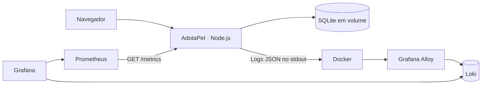
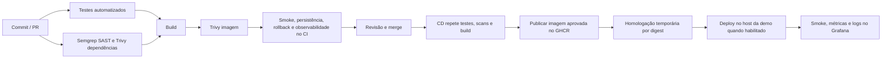

# AdotaPet

MVP de um sistema de adoção responsável de animais, desenvolvido para a disciplina **Integração DevOps — Ciência da Computação 2026/2**.

## Equipe do projeto

O projeto definido pela equipe é o **AdotaPet**, um sistema para divulgar e cadastrar animais disponíveis para adoção responsável.

| Integrante | Função |
| :---: | :--- |
| 🧑‍💻 **Luca** | **DEV** |
| 🧪 **Fernanda** | **QA / Documentação / Versionamento** |
| ⚙️ **Miguel** | **OPS / Infraestrutura** |

## Entrega 1 — Marco 1 (CI)

Esta versão atende aos requisitos iniciais da disciplina:

- Aplicação web funcional para listar e cadastrar animais disponíveis;
- API HTTP com validação dos dados;
- Banco de dados SQLite local, criado automaticamente na primeira execução;
- Testes unitários com o executor nativo do Node.js;
- Pipeline de Integração Contínua com GitHub Actions em pushes e Pull Requests para `main`.

## Tecnologias

- Node.js 22 (sem dependências externas);
- `node:sqlite` para persistência;
- HTML, CSS e JavaScript para a interface;
- GitHub Actions para CI.

## Executar localmente

Pré-requisito: Node.js 22.5 ou superior.

```bash
npm test
npm start
```

Abra `http://localhost:3000` no navegador. O arquivo do banco é gerado em `database/adota-pet.sqlite` e não é versionado.

## Testes

```bash
npm test
```

Os 10 testes verificam regras de validação, filtros e integração HTTP com SQLite: saúde, interface, cadastro, JSON inválido, rota inexistente e persistência após reiniciar a aplicação. O banco dos testes é temporário e isolado.

## Estratégia de Git

O projeto usa **Trunk-Based Development**:

1. `main` é a branch estável e sempre deve passar no pipeline.
2. Cada tarefa usa uma branch curta, como `feat/cadastro-animal` ou `fix/validacao-idade`.
3. A mudança retorna à `main` exclusivamente via Pull Request aprovado.
4. Commits seguem Conventional Commits, por exemplo: `feat: adiciona cadastro de animal` e `test: cobre filtro por cidade`.

### Proteção da branch `main`

A proteção da `main` está configurada no GitHub com:

- Branch name pattern: `main`;
- exigir Pull Request antes do merge;
- exigir aprovação de ao menos um integrante;
- exigir os checks **Testes automatizados** e **Build, persistência e rollback** aprovados;
- bloquear push direto e permitir apenas merge via Pull Request.

## Responsabilidades da equipe no Marco 1

| Integrante / papel | Responsabilidade no Marco 1 |
| --- | --- |
| Luca — DEV | Interface, API, banco de dados e regras de negócio |
| Fernanda — QA / Documentação / Versionamento | Casos de teste, revisão de Pull Requests, README e padronização de commits |
| Miguel — OPS / Infraestrutura | Repositório, proteção da `main` e configuração do GitHub Actions |

## Próxima fase

- **A3:** análise de segurança, métricas, logs, Grafana e documentação final.

## Entrega 2 — A2 (04/11/2026)

A implementação da A2 inclui Dockerfile com usuário sem privilégios e healthcheck, Docker Compose com SQLite em volume persistente, testes de integração e pipelines de CI/CD. Build, persistência e rollback foram executados com sucesso no GitHub Actions; as evidências estão vinculadas abaixo.

```bash
docker compose up -d --build --wait
```

Acesse `http://localhost:3000`. Para encerrar sem apagar os dados, use `docker compose down`.

O CD publica no GHCR em pushes na `main` e tags `vX.Y.Z`. A homologação é simulada em runner temporário: baixa a imagem publicada por digest e verifica saúde, interface, API, persistência e rollback. Logs ficam disponíveis como artefato da execução. O acesso ao registry usa `secrets.GITHUB_TOKEN`, sem credenciais no código.

## Evidências de infraestrutura — A2

- Release: [v1.0.0](https://github.com/lucaRomariz/adotapet-devops/releases/tag/v1.0.0)
- Imagem: `ghcr.io/lucaromariz/adotapet-devops:1.0.0`
- CD: [execução aprovada](https://github.com/lucaRomariz/adotapet-devops/actions/runs/41700010055)
- Homologação simulada executada no GitHub Actions.
- Persistência e rollback verificados pelo pipeline.

Conferência realizada por Miguel em 03/11/2026.


## Requisitos e evidências da A2

| Requisito | Implementação | Evidência |
| --- | --- | --- |
| Dockerfile otimizado | Base slim, contexto mínimo, usuário `node` e healthcheck | [CI aprovado](https://github.com/lucaRomariz/adotapet-devops/actions/runs/41750188596) |
| Orquestração / IaC | Compose declara aplicação, configurações, rede e volume SQLite | [Compose](docker-compose.yml) e teste de persistência |
| CD automático | Publica no GHCR e executa imagem por digest em outro runner | [CD aprovado](https://github.com/lucaRomariz/adotapet-devops/actions/runs/41750188663) |
| Configurações e segredos | `.env.example`, `.env` ignorado e `secrets.GITHUB_TOKEN` temporário | [Workflow de CD](.github/workflows/cd.yml) |
| Versionamento e rollback | Release `v1.0.0`, imagem `1.0.0`, tags SHA e falha simulada com restauração | [Release](https://github.com/lucaRomariz/adotapet-devops/releases/tag/v1.0.0) e [log preservado](docs/evidencia-homologacao-a2.log) |

O SQLite é embarcado na aplicação e guarda seus dados no volume `animal-data`, separado da imagem. O Compose provisiona o ambiente local e a homologação simulada. Não há dependência de Kubernetes ou Terraform nesta implementação.

A homologação roda em runner temporário do GitHub Actions. O ambiente é removido ao finalizar o job; não há servidor público permanente. O código disponível em GitHub Pages não substitui o servidor Node.js e a API com SQLite.

## Configurações e segredos

Para personalizar a execução local, copie `.env.example` para `.env`. `APP_PORT` define a porta local e `APP_IMAGE` seleciona a imagem. O padrão é `adotapet:local`; as configurações públicas do serviço estão no Compose. `DATABASE_DIR` aponta para o volume de dados dentro do contêiner.

O SQLite não usa senha de conexão. A autenticação no GHCR usa o secret temporário `GITHUB_TOKEN`, fornecido automaticamente pelo GitHub: `packages: write` apenas na publicação e `packages: read` no deploy. Não é necessário cadastrar um PAT para este fluxo. Não versionar `.env`, tokens ou credenciais.

As Actions estão fixadas por SHA de releases oficiais, com runtime atual, e os jobs usam Ubuntu 24.04. A versão Node.js da aplicação continua sendo 22.

## Versionamento das imagens

- `sha-<commit completo>`: rastreia cada publicação até o código de origem.
- `1.0.0`: versão semântica da entrega, correspondente à tag Git `v1.0.0`.
- `sha256:...`: digest usado no deploy para selecionar exatamente a imagem publicada.

Para a próxima release, alterar `package.json` por PR e, depois da aprovação e do merge, criar uma nova tag Git `vX.Y.Z`. O CD rejeita tags que não correspondam à versão do pacote. Usar PATCH para correções, MINOR para funcionalidades compatíveis e MAJOR para mudanças incompatíveis. Não mover tags de releases existentes.

## Reproduzir a simulação de rollback

Pré-requisitos: Docker com Compose 2.20+, Node.js 22.5+ e porta local 3000 disponível. Executar a partir da raiz do projeto:

```bash
docker compose config --quiet
docker build -t adotapet:local .
bash scripts/verify-containers.sh
```

O script realiza, em sequência:

1. Sobe a aplicação e verifica saúde, interface e API.
2. Cadastra um animal fictício, recria o contêiner e verifica os dados.
3. Cria a imagem `adotapet:broken`, cujo processo encerra imediatamente.
4. Detecta a falha da atualização e restaura a imagem anterior.
5. Verifica novamente a aplicação e a presença do animal cadastrado.

A mensagem final esperada é `Rollback aprovado com dados preservados.` A falha intermediária é proposital e não deve ser confundida com falha da execução completa.

O script usa o projeto Compose isolado `adotapet-check` e remove seu ambiente e volume de testes ao terminar. Não executar duas cópias simultaneamente na mesma máquina. Para a aplicação de uso normal, `docker compose down` preserva o banco; `docker compose down --volumes` o apaga.

### Restaurar uma imagem aprovada manualmente

Selecionar um digest anterior no resumo de uma execução aprovada do CD. Em um ambiente com dados, registrar a imagem atual e fazer backup do SQLite com a aplicação parada antes de atualizações que alterem o esquema. Não usar o volume de testes para dados reais.

```bash
# Substituir DIGEST_APROVADO pelo valor real do resumo do CD.
export APP_IMAGE=ghcr.io/lucaromariz/adotapet-devops@sha256:DIGEST_APROVADO
docker compose pull app
docker compose up -d --no-build --force-recreate --wait
node scripts/smoke.mjs
docker compose ps
```

Registrar o mesmo `APP_IMAGE` no `.env` para manter a seleção nos próximos comandos. Confirmar também o cadastro pela interface. O volume existente é reutilizado; rollback de imagem não reverte migrações do banco. Nesta fase, a simulação não modifica o esquema SQLite.

## Preservação das evidências

O [log original de homologação](docs/evidencia-homologacao-a2.log) foi extraído do artefato da [execução 41750188663](https://github.com/lucaRomariz/adotapet-devops/actions/runs/41750188663), referente ao commit `4e9e6dbb1b0a9e063eb804a1df083a8ce9f47e25`.

- Artefato original: `homologacao-4e9e6dbb1b0a9e063eb804a1df083a8ce9f47e25` (ID `13285707914`).
- SHA-256 do ZIP original, conferido com o digest exibido no GitHub: `c67fa14895e82f10480a9410268df721655afe92906b1aace58220b759c844bf`.
- Imagem testada: `ghcr.io/lucaromariz/adotapet-devops@sha256:4e78d83d7e9bd301f99d9c35e3cb2149c7692b3f27a8df309661ac3def09f597`.

A cópia versionada continua disponível após a expiração do artefato no Actions. Novas execuções solicitam retenção de 90 dias, sujeita ao limite configurado no repositório. Para guardar outra execução, baixar seu artefato na seção **Artifacts** e preservar o log com a identificação da execução e do commit; não substituir este registro histórico por logs de outro teste.

## Entrega 3 — A3 (09/12/2026)

O AdotaPet usa a mesma API Node.js e o mesmo volume SQLite da A2. A A3 integra análise de código, escaneamento de dependências e imagens, publicação por digest e telemetria em um dashboard provisionado pelo Docker Compose.

### Arquitetura



### Pipeline DevSecOps



- **Semgrep** verifica JavaScript da API e da interface. Achados ou falhas na execução bloqueiam a etapa.
- **Trivy** escaneia as dependências declaradas no repositório e os pacotes da imagem construída. Hoje a aplicação não declara dependências externas de npm. O lockfile é versionado para detectar dependências adicionadas futuramente. O pipeline bloqueia toda vulnerabilidade crítica e toda vulnerabilidade alta com correção disponível. Achados restantes aparecem no relatório JSON para triagem.
- Os artefatos `seguranca-*` ficam na execução do GitHub Actions por 90 dias. O CD publica a própria imagem escaneada e usa seu digest na homologação.
- Os checks existentes de testes e contêiner continuam sendo usados na revisão. O check de contêiner depende do check de SAST e dependências.

### Executar a stack local

Pré-requisitos de execução local com Docker: Docker Engine ou Docker Desktop e Docker Compose v2. Use a mesma senha criada na primeira inicialização enquanto o volume do Grafana existir.

```bash
cp -n .env.example .env
# Preencha GRAFANA_ADMIN_PASSWORD no arquivo .env.
docker compose -f docker-compose.yml -f docker-compose.observability.yml up -d --build --wait
```

- **AdotaPet** em http://127.0.0.1:3000.
- **Grafana** em http://127.0.0.1:3001/d/adotapet-a3 com usuário `admin` e a senha do `.env`.
- **Métricas brutas** em http://127.0.0.1:3000/metrics. Prometheus coleta a cada 5 segundos. Os gráficos de taxa usam uma janela de 1 minuto.
- **Painéis** de requisições por segundo, latência p95, erros 4xx/5xx, CPU, memória e logs HTTP. O log inclui ID da requisição, método, rota normalizada, status e duração.

Para gerar tráfego por cerca de 30 segundos, rode o comando abaixo e mantenha a janela do dashboard nos últimos cinco minutos. Os 404 exercitam a série 4xx. A série 5xx acompanha erros do servidor.

```bash
for i in $(seq 1 30); do
  curl -fsS http://127.0.0.1:3000/api/animals >/dev/null
  if [ "$((i % 5))" -eq 0 ]; then
    curl -sS http://127.0.0.1:3000/rota-da-demo >/dev/null
  fi
  sleep 1
done
```

Para parar a stack preservando os volumes:

```bash
docker compose -f docker-compose.yml -f docker-compose.observability.yml down
```

### Preparar o ambiente da apresentação — Miguel

1. Preparar um host Linux x64 isolado e alcançável por SSH a partir do GitHub Actions. A conta de deploy deve ter Docker Compose v2, Node.js 22 no PATH, portas locais 3000 e 3001 livres e acesso de leitura à imagem no GHCR. Se o pacote for privado, configurar previamente a autenticação de leitura nessa conta do host.
2. Criar o Environment `homologacao` com deploy limitado a `main`. Cadastrar os secrets `GRAFANA_ADMIN_PASSWORD`, `DEMO_SSH_KEY` (chave privada dedicada sem senha) e `DEMO_SSH_KNOWN_HOSTS` (chave pública do host conferida por canal confiável). Configurar `DEMO_SSH_TARGET` no Environment no formato `usuario@host`, com SSH na porta 22. Depois de preparar o host, definir **no repositório** a variável `DEMO_DEPLOY_ENABLED=true`.
3. Disparar o workflow **CD** em `main` e conferir o job **Deploy no ambiente da apresentação**. O job atualiza por digest, preserva o volume e valida aplicação, dashboard, métricas e logs. Se a atualização falhar, o script tenta restaurar a imagem anterior a partir do cache do host.
4. Acessar os serviços pelo navegador local após abrir um túnel SSH. O Compose publica as portas apenas em loopback.

```bash
ssh -N -L 3000:127.0.0.1:3000 -L 3001:127.0.0.1:3001 usuario@host
```

### QA e evidências — Fernanda

| Verificação | Evidência esperada |
| --- | --- |
| PR aprovado | Links dos checks **Testes automatizados**, **SAST e dependências** e **Build, persistência e rollback** |
| Gate de segurança | JSON de SAST, dependências e imagem. O status do job e a saída do gate indicam eventuais bloqueios |
| Homologação | Resumo do CD com digest implantado e smoke aprovado |
| Observabilidade | Captura dos seis painéis e log associado a uma requisição pelo ID |
| Recuperação | Saída do teste de rollback com dados preservados |

A verificação automatizada em `scripts/verify-observability.sh` sobe uma stack isolada, gera uma requisição e consulta as fontes pelo Grafana para confirmar o dashboard, uma série HTTP e o log com o mesmo ID.

### Riscos e post-mortem

| Risco | Prevenção e resposta |
| --- | --- |
| Imagem ou dependência vulnerável | Rastrear o achado pelo JSON, atualizar o pacote ou a base e rodar o pipeline novamente |
| Imagem passa no build e falha após atualização | Validar saúde e telemetria após implantar por digest e restaurar a imagem anterior se necessário |
| Perda dos dados durante a demo | Preservar o volume SQLite e manter backup antes da apresentação |
| Acesso do Alloy ao Docker | Executar a stack em host isolado. O socket Docker dá acesso privilegiado ao daemon mesmo quando montado com `:ro` |
| Logs com dados pessoais ou cardinalidade alta | Registrar rota normalizada e evitar payload, query string e dados do cadastro |
| Host da demo indisponível | Ensaiar no host da apresentação e guardar o link de uma execução aprovada e a stack local como contingência |

**Cenário de post-mortem simulado.** O teste de rollback usa uma imagem que encerra imediatamente após iniciar. O healthcheck detecta a falha e a aplicação fica indisponível durante a tentativa de atualização. O script restaura a imagem anterior e confirma que o registro de teste continua no SQLite. A evidência da A2 está em `docs/evidencia-homologacao-a2.log`. A confirmação no ambiente da A3 deve ser registrada na execução do workflow.

**Ocorrência da A3.** O primeiro scan bloqueou a imagem baseada em Debian Bookworm. O Trivy sinalizou o zlib da base e dependências trazidas pelo npm da imagem oficial de Node, embora a aplicação rode diretamente com Node. O Dockerfile passou a copiar somente o executável Node.js para uma base Debian Trixie, com as bibliotecas de runtime, incluindo a atualização de segurança do zlib disponível no repositório Debian. O usuário do contêiner manteve UID/GID 1000 para acesso ao volume existente.

### Roteiro para a apresentação

1. **Luca** altera um texto visível em `public/index.html`, faz commit, envia a branch e abre o PR.
2. **Fernanda** acompanha os checks, mostra os relatórios e revisa o PR. Com os checks verdes e a aprovação registrada, a equipe integra a alteração.
3. **Miguel** acompanha o CD, mostra o digest e o smoke test e abre a aplicação atualizada no host da demo.
4. A equipe executa o loop de tráfego e mostra o Grafana com p95, 4xx/5xx, tráfego, CPU, memória e um log HTTP. Se houver atraso externo, mostra a execução aprovada do ensaio e identifica a contingência.
